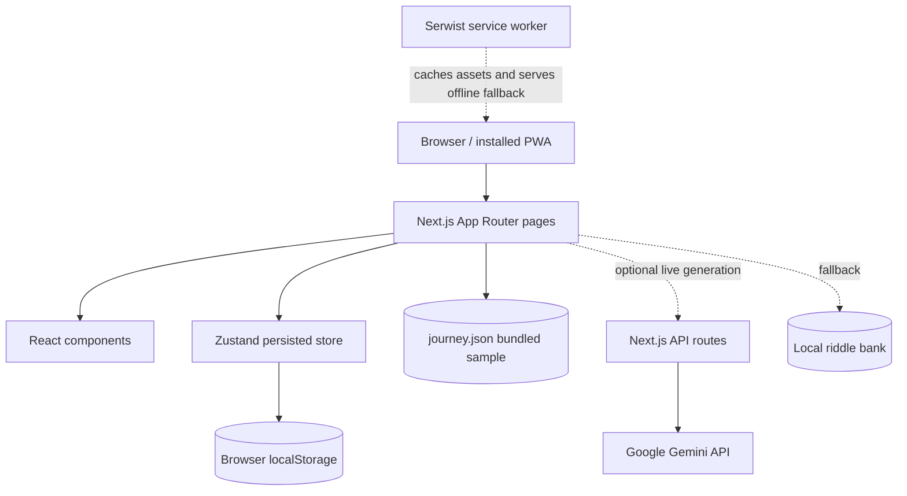

# Runway 250 — Project Blueprint

This guide explains the repository as it exists on `main` at the time of review. It distinguishes the interactive prototype from its fixed sample journey and from ideas described in older planning documents.

## Contents

1. [Product and maturity](#product-and-maturity)
2. [Technology and project layout](#technology-and-project-layout)
3. [Application architecture](#application-architecture)
4. [Routes and user experience](#routes-and-user-experience)
5. [State, data, and persistence](#state-data-and-persistence)
6. [Game model and worked examples](#game-model-and-worked-examples)
7. [AI and offline behavior](#ai-and-offline-behavior)
8. [Setup and operations](#setup-and-operations)
9. [Security, limitations, and extensions](#security-limitations-and-extensions)

## Product and maturity

Runway 250 is a single-player, life-planning game concept presented as an installable web app. Its central metaphor is that small real-world actions make a pixelated avatar progressively clearer over a 250-day timeline. Players can select six focus areas (Body, Mind, Craft, Voice, Order, Bonds), work through short quests, write a reflection, and explore milestones in a pre-generated journey.

The product is presently a **feature-rich demonstration prototype**. It combines real UI interactions with a fixed, fictional sample history. It has no registered users, production database, cross-device synchronization, payment integration, or observed cohort. The pitch analytics and business proposals are explicitly illustrative. The optional Gemini endpoints generate quest and riddle content, but their presence does not make the 250-day journey personalized or adaptive.

The old [`BLUEPRINT.md`](BLUEPRINT.md) is retained as a historical build specification. Where it describes planned mechanics, researched claims, or intended behavior, treat those as design notes rather than proof of implementation.

## Technology and project layout

| Technology | Role in this repository |
| --- | --- |
| Next.js 16 App Router | File-based pages, shared root layout, and server route handlers |
| React 19 + TypeScript 5 | Interactive UI and typed application code |
| Tailwind CSS 4 | Utility-based styling in `app/globals.css` and page/component class names |
| Zustand 5 | Client-side application state, persisted by the browser storage middleware |
| Framer Motion 12 | Page transitions, avatar/journey motion, and ending sequence |
| Recharts 3 | Pitch-mode data visualizations |
| Serwist 9 | Production service worker, precaching/runtime caching, offline document fallback |
| `@google/genai` | Optional Gemini quest and riddle generation in server routes |
| Lucide React | Interface icons |

Exact declared dependencies and scripts are in [`package.json`](package.json); bundler and service-worker wiring are in [`next.config.ts`](next.config.ts).

```text
app/
  page.tsx                 Landing page
  onboarding/page.tsx      Focus selection and calibration flow
  today/page.tsx           Daily quest, reflection, riddle, completion flow
  journey/page.tsx         Seed journey scrubber, playback, milestones
  archive/page.tsx         Chronological sample and saved reflections
  settings/page.tsx        Preferences and pitch controls
  analytics/page.tsx       Pitch-only illustrative charts
  business/page.tsx        Pitch-only proposed business model
  about/page.tsx           Product concept and disclosure
  api/quest/route.ts       Optional Gemini quest endpoint
  api/riddle/route.ts      Optional Gemini riddle endpoint
  manifest.ts, sw.ts       PWA metadata and service worker source
src/
  components/              Shared UI and experience components
  store/useRunwayStore.ts  Zustand state and local persistence
  lib/ai/                  Prompt construction
  lib/data/                Seed journey, generator, and sample cohort
  lib/game/                Formulas, riddle bank, audio, vocabulary
```

In Next.js App Router, folders under `app/` define URL routes. A `page.tsx` renders a screen; `route.ts` defines a server endpoint. Files under `src/` hold reusable logic and components. Most stateful screens declare `"use client"` because they use browser APIs, event handlers, or React hooks.

## Application architecture

The project has three main data paths: static sample data imported by the client, browser-persisted user interactions, and optional server-mediated Gemini requests.



The root layout in [`app/layout.tsx`](app/layout.tsx) sets global fonts, metadata, theme provider, navigation, pitch banner, simulation disclosure, and page frame. The store in [`src/store/useRunwayStore.ts`](src/store/useRunwayStore.ts) is a browser state container: Zustand updates React subscribers, and its `persist` middleware serializes the selected store state to the key `runway-storage` in `localStorage`.

### Important components

| Component | Responsibility |
| --- | --- |
| [`Navigation`](src/components/Navigation.tsx) | Bottom navigation; pitch-only links depend on stored mode |
| [`ThemeProvider`](src/components/ThemeProvider.tsx) | Applies the stored light/dark preference |
| [`PixelAvatar`](src/components/PixelAvatar.tsx) | Visual avatar whose blur/resolution follows a supplied percentage |
| [`QuestTile`](src/components/QuestTile.tsx) | Displays and completes a quest, including hunt input |
| [`SessionTimer`](src/components/SessionTimer.tsx) | Counts down the daily session and updates session state |
| [`MilestoneBadge`](src/components/MilestoneBadge.tsx) | Displays a milestone chapter |
| [`EndingSequence`](src/components/EndingSequence.tsx) | Day 250 cinematic ending and sample journey recap |
| [`SimulationBadge`](src/components/SimulationBadge.tsx) | Keeps the demo/simulation disclosure visible |

## Routes and user experience

The route names below correspond to folders in `app/`.

| Route | Experience and implementation status |
| --- | --- |
| `/` | Product introduction, avatar comparison, design promises, and onboarding entry |
| `/onboarding` | Client-side selection of pillars, calibration inputs, and animated start of the run |
| `/today` | Daily ritual: quests, completion toggles, optional hunt description, reflection, resolution animation, local riddle, session completion, and final-day ending |
| `/journey` | Scrubs or plays the fixed 250-day JSON journey; reveals milestone cards and sample reflections |
| `/archive` | Lists all 250 sample days and prefers a saved reflection when one exists; later sample days are visually locked relative to the selected day |
| `/settings` | Appearance, sound, live-generation toggle, session/reset actions; a long press toggles pitch mode and exposes demo controls |
| `/analytics` | Pitch-mode charts over seeded journey and explicitly simulated cohort data |
| `/business` | Pitch-mode proposed monetization/pricing and competitor comparison; not a functioning checkout |
| `/about` | Concept explanation, behavior-design rationale, and demonstration disclosure |
| `/~offline` | Styled offline page used as the service-worker document fallback |

The daily screen's local state machine is `QUESTS → REFLECTION → RESOLVING → COMPLETED`. The quest stage allows completion and hunt descriptions. The reflection stage saves text to the store. Resolving animates the displayed resolution to the selected seed day's baseline, then locks the session. A completed session can open a local riddle (or ask the optional API) and shows the day-complete presentation. The 10-minute timer displays a reminder at zero; it does not itself lock the session. See [`app/today/page.tsx`](app/today/page.tsx) and [`src/components/SessionTimer.tsx`](src/components/SessionTimer.tsx).

The navigation and page content use in-world terms, while the code keeps ordinary names such as `Quest`, `currentDay`, and `liveAI`. The lexicon is a vocabulary helper, not a translation or localization system: [`src/lib/game/lexicon.ts`](src/lib/game/lexicon.ts).

## State, data, and persistence

### Two different kinds of data

1. **Seeded sample history:** [`src/lib/data/journey.json`](src/lib/data/journey.json) contains a fictional 250-day journey with quests, completions, streaks, XP, resolution percentages, reflections, and milestones. Screens import this JSON directly; it is not stored per account or built from the current player's actions.
2. **Browser interaction state:** Zustand persists preferences, selected day, selected pillars, live-generated quests, reflections, solved riddles, and session flags in `localStorage`. This storage is scoped to the browser profile and origin. Clearing site data or using another browser removes or isolates it.

The `Quest` type is declared in the store and includes `id`, `pillar`, `tier`, `text`, `anchor`, `done`, and optional hunt fields (`isHunt`, `description`). The store also holds `darkMode`, `liveAI`, `currentDay`, `mode`, `soundEnabled`, `sessionTimeLeft`, `isSessionLocked`, `selectedPillars`, `liveQuests`, `solvedRiddles`, and `reflections`.

`currentDay` represents the selected position in the sample. The journey scrubber and pitch settings change it for preview; completing the daily ritual does not automatically progress it or rebuild the seeded streak/XP records. In Game Mode, the daily screen still permits local quest interaction and reflection, but the underlying seeded outcome remains the reference curve.

### Static journey schema

The generator in [`src/lib/data/generateJourney.ts`](src/lib/data/generateJourney.ts) writes `journey.json`. A day record contains:

| Field | Meaning |
| --- | --- |
| `day`, `act` | Day number 1–250 and one of Boot, Rendering, Sharpening, HighDef |
| `energy` | Seeded energy level, 1–3 |
| `quests` | Sample day quests and seeded completion flags |
| `reflection` | Prewritten demonstration text, not a participant's log |
| `streak`, `freezeUsed` | Simulated streak and freeze behavior |
| `xpGained`, `cumulativeXP` | Simulated day and running XP totals |
| `resolutionPct` | Seed curve value used by avatar and journey displays |
| `milestone` | Optional sample chapter message |

The checked-in data has 250 entries, a final sample resolution of 98.4%, and two all-quest-missed days. Those are properties of the generated fixture, not product outcomes or user research.

## Game model and worked examples

The scoring helpers live in [`src/lib/game/formulas.ts`](src/lib/game/formulas.ts). The seeded generator uses them to create the fixed sample. The interactive daily loop does **not** feed its completed quests into the XP formula to produce a new cumulative score.

### Tier points and streak multiplier

Base points are Tiny = 10, Standard = 25, Hard = 50. The code calculates:

```text
multiplier = 1 + min(streak, 30) × 0.01
dailyXP = round(sum(points for completed quests) × multiplier)
```

Example: completing one Tiny (10) and one Standard (25) quest at a 10-day streak gives `round((10 + 25) × 1.10) = 39 XP`. The streak multiplier tops out at 1.30. In generated sample data, a missed day can use one of two freezes; a freeze preserves the streak. A clean day adds to streak, and the seed script restores one used freeze after each 14 clean days, up to two. These are simulation rules; there is no live adaptive streak engine in the daily UI.

### Resolution curve

For cumulative XP `x`, the formula is:

```text
resolution = roundTo1Decimal(100 × (1 − exp(−2.5 × x / 6000)))
```

For `x = 3000`, the result is `100 × (1 − exp(−1.25)) ≈ 71.3%`. This curve rises quickly early on, then approaches 100% without reaching it. The checked-in sample reaches 9,990 cumulative XP and 98.4% resolution.

There is a mismatch in the historical [`BLUEPRINT.md`](BLUEPRINT.md): it says 6,000 XP is tuned to produce 97–99%, but the implemented formula gives about 91.8% at exactly 6,000 XP. The checked-in seed instead produces roughly 9,990 XP. This guide follows the formula and data in source.

### Seed generation

The sample generator uses a fixed-seed linear congruential random number generator, chooses quest templates from six pillar pools, assigns tiers from energy, and models a dip/recovery pattern in daily completion probabilities. It fixes two missed days on days 30 and 45, keeps ordinary generated days from becoming missed by chance, calculates score and resolution, then writes JSON. The generator's “automatic tuning” changes a probability scale until the final resolution enters its configured band.

Its deterministic seed makes the fixture reproducible under the same code. The generator is a way to construct a convincing demo arc, not an inference model: the probabilities, persona copy, streaks, and analytics have not been validated with real participants.

## AI and offline behavior

When the `liveAI` setting is enabled, `/today` posts selected pillars, sample recent quest history, and energy to `/api/quest`. The route builds a prompt and calls Gemini using the server-side `GEMINI_API_KEY`. The client aborts quest requests after six seconds and falls back to static quests if generation fails. The riddle endpoint at `/api/riddle` receives today's quest text and returns a riddle/answer; the client falls back to the local bank in [`src/lib/game/riddles.ts`](src/lib/game/riddles.ts).

The API routes are [`app/api/quest/route.ts`](app/api/quest/route.ts) and [`app/api/riddle/route.ts`](app/api/riddle/route.ts); prompt construction is in [`src/lib/ai/prompt.ts`](src/lib/ai/prompt.ts). The browser never needs the Gemini key. A key is only needed for live generation; seeded quest/riddle behavior works without it.

PWA setup is split across [`app/manifest.ts`](app/manifest.ts), [`app/sw.ts`](app/sw.ts), and [`next.config.ts`](next.config.ts). The service worker is disabled in development by configuration. Production service-worker behavior should be checked through a production build and browser, not inferred from the source alone. The documented `/~offline` fallback handles document requests; an offline shell is not the same as offline AI generation.

## Setup and operations

Use a Node.js version supported by the declared Next.js version (the repository's `AGENTS.md` calls out Node 20.9 or newer). Then:

```bash
npm ci
npm run dev
```

Visit `http://localhost:3000`. To enable live Gemini generation, place the key in an untracked local `.env.local` file:

```text
GEMINI_API_KEY=your_key_here
```

Keep the key server-side; do not prefix it with `NEXT_PUBLIC_`. Without it, `/api/quest` and `/api/riddle` return fallback errors which the client handles with local content.

| Command | What it does |
| --- | --- |
| `npm run lint` | Runs ESLint |
| `npm run seed` | Recreates `src/lib/data/journey.json` from the seeded generator |
| `npm run seed:check` | Reports fixture length, resolution, missed days, freezes, and checkpoints |
| `npm run build` | Builds the Next.js app and production service worker |
| `npm start` | Serves a prior production build |

`package.json` does not declare a test script or test framework. Do not treat the build log's historical QA statements as a current verification result. A production PWA check requires building and opening the result in a browser with service-worker support.

### Troubleshooting

- **AI content falls back:** check that `.env.local` contains `GEMINI_API_KEY`, restart the dev server after editing it, and inspect the terminal for API errors. Fallback is expected without a key or network.
- **The UI starts at an unexpected day or mode:** the persisted `runway-storage` browser value can outlive a code reload. Use the app's reset control or clear that site's browser storage.
- **Offline page does not appear in dev:** Serwist is configured off in development. Check the service worker using a production build instead.
- **Journey values do not follow newly completed tasks:** this is the current architecture; daily interactions are not recalculating the seeded timeline.

## Security, limitations, and extensions

### Current boundaries

- There is no login, authorization model, server-side personal-data store, backup, or sync. Browser-stored reflections may be readable by someone with access to the same unlocked browser profile.
- Gemini requests leave the device and go through the configured server API to Google. Keep `GEMINI_API_KEY` on the server. The routes rely on prompt/schema behavior and do not implement comprehensive request validation, abuse limits, or account-based quotas.
- Analytics and cohort comparisons use sample data; they cannot establish retention, outcomes, or market demand. Business prices and monetization models are proposals, not implemented purchase flows.
- The seed history is fixed and the day selector is primarily a demo control. Real progress does not yet drive the same streak, freeze, XP, resolution, or analytics paths.
- The 10-minute timer is a reminder; it does not automatically end or lock an overlong session. The lock is applied after the reflection/resolve step.
- The repository's `BUILDLOG.md` names `https://runway250-beta.vercel.app`; that address was not verified as reachable during this review, so it is not presented as a live demo link.
- `BLUEPRINT.md` contains earlier product specification claims, research figures, and proposed mechanics. Check them independently before reusing them as current product facts.

### Sensible next extensions

If the goal shifts from pitch prototype to personal product, the smallest architectural step is to define a real `DayRecord` lifecycle: start a day, persist quest completion/reflection, calculate XP and streak from actual user actions, then advance the selected day. Add schema validation and migrations for persisted data, plus export/restore before introducing accounts or sync. For live generation, validate request shapes and model output on the server, impose rate/cost limits, and explain what data is sent. For analytics, collect consented and privacy-reviewed events only after real usage exists; never relabel fixture data as observed results.

These are extension paths, not claims about current implementation.
